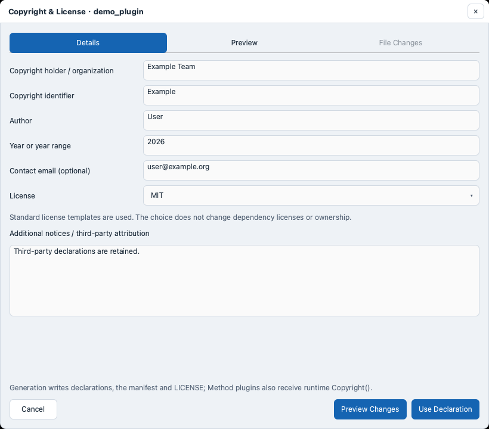
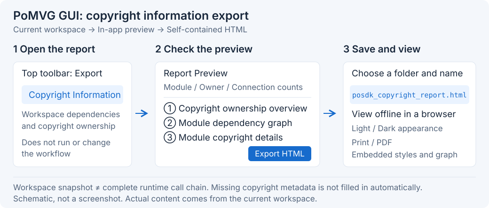

.. _copyright-tracking:

Copyright Information
=====================

View Copyright Information
--------------------------

1. Open a workflow and select a module.
2. Open **Configuration → Info** to view its copyright identifier, author, year, and declaration.

Edit Copyright Information
--------------------------

Option 1: GUI Editing
~~~~~~~~~~~~~~~~~~~~~

Create a Plugin
^^^^^^^^^^^^^^^

1. Open **Develop**, link your writable Plugin SDK, choose Method or Data, and fill in the plugin definition.
2. Under **Copyright & License**, click **Edit Copyright / Choose License…**.
3. Enter the holder, copyright identifier, author, year, and optional email.
4. Choose **MIT, BSD-2-Clause, BSD-3-Clause, Apache-2.0, MPL-2.0**, or **Custom**. For Custom, enter the full license text.
5. Click **Preview Changes**, review the content, then click **Use Declaration**. Return to Develop and generate the plugin.

Edit an Existing Plugin
^^^^^^^^^^^^^^^^^^^^^^^

1. Select the plugin or open its source in **IDE → Integrated**, then click **© Copyright** at the upper right.
2. Edit the fields and click **Preview Changes**. Review the before and after content under **File Changes**.
3. Click **Confirm & Save**. If a file-change message appears, preview again before saving.
4. Click **Rebuild**, then refresh Modules after the build completes.
5. Drag the plugin into the workspace, select its node, and check the declaration under **Configuration → Info**.

Save source edits and finish any build or debug session before editing. After an Agent or CLI change, reopen **© Copyright** to view the latest information.
To restore an original file, retrieve it from ``.posdk-copyright-backups/`` in the plugin directory and rebuild.

Option 2: Source Editing
~~~~~~~~~~~~~~~~~~~~~~~~

1. **Override** ``Copyright()`` in the registered Method class:

   .. code-block:: cpp

      PoSDK::Interface::CopyrightData Copyright() const override {
          return {"ExampleLab", "Copyright (c) 2026 Example Lab\n"
                                "Author: Example Author\nLicense: MIT\n"};
      }

2. Update source notices, the ``author`` / ``license`` / ``copyright`` fields in ``manifest.json``, ``LICENSE``, and third-party notices.
   For Data plugins, edit the copyright information in these files directly.
3. Rebuild and refresh the plugin, then check the declaration on the node's **Info** tab.

For a direct ``Method`` subclass, call ``StartCopyrightTracking()`` at the start of ``Build()`` and ``StopCopyrightTracking()`` on return and exception paths.
For ``MethodPreset`` or ``MethodPresetProfiler``, override ``Copyright()``.

Option 3: Agent Assistance
~~~~~~~~~~~~~~~~~~~~~~~~~~

1. Click **IDE → Integrated** at the top and select the plugin in the development plugin list on the left. If it is already open, keep using that page and save any source edits.
2. Click **Agent** at the top to open the chat panel on the right. If **Plan** below the message box is enabled, turn it off.
3. Click **Permissions…** above the message box to open **Agent permissions**.
4. Find **Focused plugin project** in the directory list, check that its path points to the plugin you want to edit, and select **Read** and **Write** for that row. Click **Approve & apply**.
   If the folder is missing, click **+ Directory**, select the plugin folder, then select its permissions and apply them.
5. Return to the message box and send a request like the one below. Replace the example holder, author, year, and license with your own information:

   Please edit the copyright of the plugin open in my IDE: holder Example Lab, author Example Author, year 2026, license BSD-3-Clause. Retain existing third-party notices and save the changes.

6. When Agent reports completion, return to **IDE → Integrated** and click **© Copyright** at the upper right of the editor. Check that the displayed information is correct.
7. Click **Rebuild** below the IDE and wait for the console to report that the build has completed.
8. Open **Modules**, refresh the list, and drag the plugin into the workspace. Select the module and open **Configuration → Info** on the right to view its copyright declaration.

Command-line Import (Optional)
^^^^^^^^^^^^^^^^^^^^^^^^^^^^^^

1. Generate a template and inspect the current information. Replace ``path/to/MyMethod`` with the plugin source directory:

   .. code-block:: bash

      posdk plugin copyright template > copyright.json
      posdk plugin copyright inspect --source path/to/MyMethod

2. Edit ``copyright.json``, using strings for all values:

   .. code-block:: json

      {
        "schema": "posdk.plugin-copyright.v1",
        "copyrightId": "ExampleLab",
        "holder": "Example Lab",
        "author": "Example Author",
        "year": "2026",
        "email": "author@example.org",
        "license": "BSD-3-Clause",
        "additionalNotices": "",
        "customLicenseText": ""
      }

   Keep ``schema`` and fill in the identifier, holder, author, year, and license.
   For a custom license, set ``license`` to ``LicenseRef-Custom`` and enter the full text in ``customLicenseText``.

3. Save source edits, then preview the changes:

   .. code-block:: bash

      posdk plugin copyright import --source path/to/MyMethod --metadata-file copyright.json

4. Replace ``PREVIEW_SHA256`` below with the returned ``planSha256`` and save. Preview again if you change the source or JSON:

   .. code-block:: bash

      posdk plugin copyright import --source path/to/MyMethod --metadata-file copyright.json --apply --expect-sha256 PREVIEW_SHA256

5. Rebuild and refresh the plugin. Check **© Copyright** or the node's **Info** tab.

.. _third-party-copyright-important:

Enter Third-Party Notices
~~~~~~~~~~~~~~~~~~~~~~~~~

Enter dependency copyright and license information under **Additional notices / third-party attribution**.
For CLI edits, use ``additionalNotices``. For source edits, include it in the declaration and ``THIRD_PARTY_NOTICES.md``, retaining existing notices.

.. _copyright-gui-export:

Export a Copyright Report
-------------------------

1. Open the workflow and check its modules and connections.
2. Choose **Export → Copyright Information** to preview the report.
3. Click **Export HTML** at the upper right, then choose a file name and folder.
4. Open the report in a browser. For a PDF, click **Print / PDF** and save.

