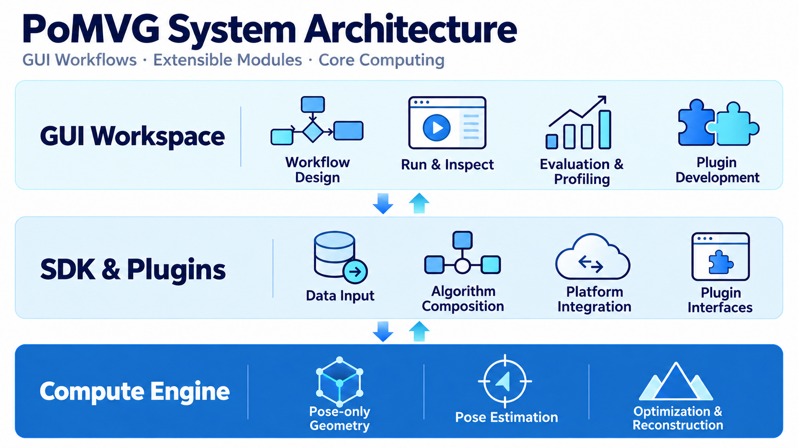
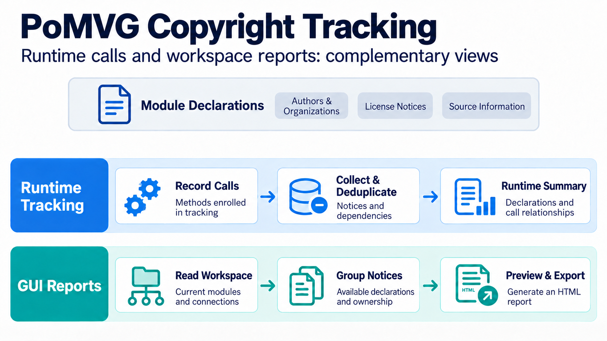

PoMVG User Guide
=================

**GitHub Repository**: https://github.com/pose-only-vision/PoSDK

PoMVG is a C++ software platform for **Spatial Visual Computing**, designed for 3D multi-view geometry processing, including camera pose estimation, feature point cloud generation, and more.

PoMVG provides a GUI and a CLI. Use the GUI to build workflows, run algorithms, inspect accuracy and performance reports, and compare results in 3D. Use the CLI for repeatable runs and batch processing.

**Future feature updates and user documentation focus on the GUI version.** The v1.0.0 documentation remains available as a historical reference.

To run your first dataset, start with the :doc:`Quick Start <installation/cli_gui_guide>`.
It walks through ETH3D setup and execution, evaluation, profiling, copyright information and 3D results, followed by optional Agent, IDE and plugin development features.

Core Features
-------------

- **Pose-only Geometry Theory**: Estimate camera poses and reconstruct point clouds using Pose-only Imaging Geometry. Select a corresponding workflow in the GUI, associate image data and run it.
- **Modular Plugin System**: Organize data loading, algorithms and outputs as workflow nodes. Drag, connect and configure them to combine functions; developers can also add their own plugins.
- **Performance Profiling Tools**: Use **Profiler** to inspect recorded module timings, CPU and memory statistics. Export CSV data to identify slower processing steps.
- **Automatic Evaluation**: Use **Evaluator** to inspect recorded accuracy metrics such as rotation and translation errors, compare means, medians and charts, and export data. Accuracy evaluation requires suitable reference data.
- **Copyright Tracking**: Collect copyright declarations for algorithms and dependencies. Inspect a node's **Information** tab or open **Export → Copyright Information** for a combined report.
- **Bilingual Logging**: Read Chinese and English logs in Console to follow progress and identify errors. Change the interface language in **Preferences → Language**.
- **Platform Integration and Comparison**: Process data using installed platform plugins such as OpenMVG, COLMAP and GLOMAP, then compare metrics and 3D results. See :doc:`Evaluation Results <benchmark_comparison/results>` for existing comparisons.

The basic GUI sequence is: **open a workflow → associate data → run → inspect accuracy and performance → check the 3D result → export reports**.
Agent can help explain or adjust a workflow, and IDE supports plugin development. Neither is required to run an existing workflow.

System Architecture
-------------------

PoMVG uses GUI workflows to organize processing, the SDK to combine algorithm modules, and the core engine to perform geometric computation. Results return to the GUI for inspection, evaluation and export.

   The GUI organizes workflows, the SDK connects extensible modules, and the core engine performs computation.

The main components include:

- **GUI Workspace**: Build workflows, configure data, run algorithms, inspect point clouds, accuracy and performance, and access plugin development tools.
- **SDK and Plugin Extensions**: Connect data, algorithms and third-party platforms through composable modules; developers can extend processing steps as needed.
- **Core Computing Engine**: Provides pose-only geometry, pose estimation, optimization and reconstruction.

Saved workflows can also run through the CLI for repeatable runs and batch processing.

Copyright Tracking and Intellectual Property Protection
--------------------------------------------------------

PoMVG has built-in **automatic copyright tracking functionality**.

Why Copyright Tracking?
~~~~~~~~~~~~~~~~~~~~~~~

A reconstruction may combine several algorithms and third-party tools. Retaining the authors, organizations and license notices provided by each component helps identify algorithm sources, check dependencies and archive results.

PoMVG Solution
~~~~~~~~~~~~~~

PoMVG copyright tracking provides the following features:

- **Declaration Collection**: Records available copyright information provided by modules.
- **Runtime Tracking**: Associates calls by methods enrolled in tracking and summarizes their declarations.
- **Grouped Display**: Organizes related methods by copyright identifier to reduce repetition.
- **GUI Preview and Export**: Generates reports from the current workspace's modules, connections and available declarations.

   Runtime tracking reflects recorded calls; GUI reports reflect the current workspace's modules and connections.

How It Works
~~~~~~~~~~~~

As shown in the figure above, the copyright tracking workflow is as follows:

1. **Module Declarations**: Record available information such as authors, organizations and license notices.
2. **Runtime Association**: Track calls by participating methods, organize declarations and dependencies, and write summaries to the runtime log.
3. **Workspace Summary**: The GUI organizes a report using canvas modules, connections and available copyright metadata.
4. **Inspection and Archiving**: Inspect declarations in a node's **Information** tab; use **Export → Copyright Information** to preview and export an HTML report.

The two views can be checked together. The GUI workspace report does not expand internal runtime calls within modules.

For detailed usage, please refer to: :doc:`Copyright Tracking Feature Documentation <copyright_tracking>`

Automatic Evaluation
--------------------

PoMVG includes **evaluation tools** for accuracy statistics, result comparison and data analysis.

Why Automatic Evaluation?
~~~~~~~~~~~~~~~~~~~~~~~~~~

In research and application development, it is often necessary to:
- Compare performance of different algorithms on the same dataset
- Evaluate the same algorithm's performance under different parameter configurations
- Statistically analyze evaluation results (mean, median, standard deviation, etc.)
- Export CSV for later comparison

**Problem**: Manual data collection and statistical calculation require significant effort.

PoMVG Solution
~~~~~~~~~~~~~~

PoMVG accuracy evaluation system provides the following features:

- **Automatic Collection**: Automatically collects algorithm evaluation results (rotation error, translation error, reprojection error, etc.)
- **Intelligent Classification**: Automatically categorizes and manages by evaluation type, algorithm name, and metric name
- **Statistical Analysis**: Automatically calculates statistics such as mean, median, max/min values, standard deviation, etc.
- **CSV Export**: Supports multiple CSV data export formats for subsequent analysis
- **Multiple Annotation Types**: Supports adding various types of annotation information to each evaluation result (such as view pair identifiers)

For detailed usage, please refer to: :doc:`Evaluation System Documentation <advanced_development/evaluator_manager>`

Platform Integration and Comparison
------------------------------------

PoMVG supports integration and comparison testing with multiple mainstream 3D reconstruction platforms, including OpenMVG, COLMAP, GLOMAP, etc.

Why Platform Comparison?
~~~~~~~~~~~~~~~~~~~~~~~~~

Current mainstream 3D reconstruction platforms each have their own characteristics:
- **OpenMVG**: Classic open-source multi-view geometry library providing complete SfM workflow
- **COLMAP**: Industry-leading 3D reconstruction system supporting SfM and dense reconstruction
- **GLOMAP**: New-generation global optimization platform focusing on rapid reconstruction of large-scale scenes

**Problem**: How to objectively evaluate the performance and accuracy of different platforms on the same dataset?

PoMVG Solution
~~~~~~~~~~~~~~

PoMVG provides a unified comparison testing framework:

- **Unified Data Format**: Supports converting outputs from different platforms into a unified data format for comparison
- **Automated Testing**: Implements automated batch testing through configuration files and scripts
- **Multi-dimensional Evaluation**:
  - **Performance Comparison**: Performance metrics such as runtime and memory consumption
  - **Accuracy Comparison**: Accuracy metrics such as global pose errors (rotation/translation) and relative pose errors
  - **Statistical Analysis**: Statistics such as mean, median, max/min values, standard deviation, etc.

How to Use the Comparison Feature
~~~~~~~~~~~~~~~~~~~~~~~~~~~~~~~~~~

1. **Prepare Data**: Ensure the dataset contains ground truth information
2. **Configure Testing**: Specify platforms and parameters to compare in configuration files
3. **Run Tests**: Execute automated tests using provided scripts
4. **View Results**: System automatically generates comparison reports and visualization charts

For detailed comparison test results and analysis, please refer to: :doc:`Evaluation Results <benchmark_comparison/results>`

---

**Next Steps**: Run your first dataset with :doc:`Quick Start <installation/cli_gui_guide>`. If PoMVG is not installed yet, start with the :doc:`Installation Guide <installation/index>`.

