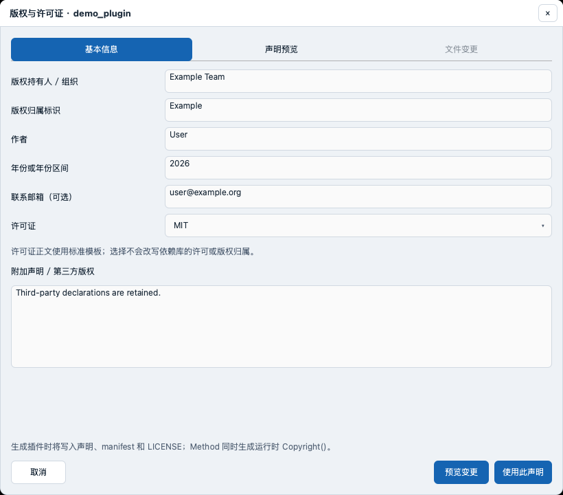
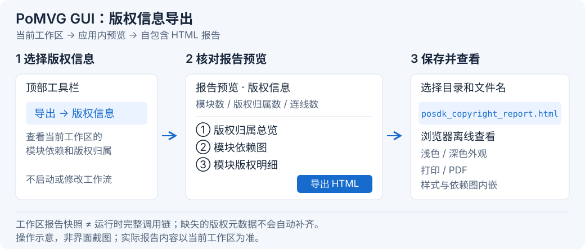

.. _copyright-tracking:

版权信息
========

查看版权信息
------------

1. 打开工作流，选中需要查看的模块。
2. 在右侧 **Configuration → 信息** 中查看版权标识、作者、年份和声明。

编辑版权信息
------------

方式一：GUI 编辑
~~~~~~~~~~~~~~~~

新建插件
^^^^^^^^

1. 打开 **开发**，关联自己的可写 Plugin SDK，选择 Method 或 Data 并填写插件定义。
2. 在 **版权与许可证** 中点击 **编辑版权 / 选择许可证…**。
3. 填写持有人、版权归属标识、作者、年份及可选邮箱。
4. 选择 **MIT、BSD-2-Clause、BSD-3-Clause、Apache-2.0、MPL-2.0** 或 **自定义**；选择自定义时填写完整许可正文。
5. 点击 **预览变更**，核对后点击 **使用此声明**，返回开发向导生成插件。

修改已有插件
^^^^^^^^^^^^

1. 在 **IDE → 集成** 中选择插件或打开其源文件，点击右上角的 **© 版权**。
2. 修改信息并点击 **预览变更**；在 **文件变更** 中核对修改前后的内容。
3. 点击 **确认保存**。若提示文件已更改，请重新预览后保存。
4. 点击 **重建**，构建完成后刷新模块列表。
5. 将插件拖入工作区，选中节点，在 **Configuration → 信息** 中核对版权声明。

编辑前保存源码并结束构建或调试。Agent 或 CLI 修改后，重新点击 **© 版权** 查看最新信息。
需要恢复原文件时，从插件目录的 ``.posdk-copyright-backups/`` 中取回备份，再重新构建。

方式二：源码编辑
~~~~~~~~~~~~~~~~

1. 在注册的 Method 类中 **重载** ``Copyright()`` **函数**：

   .. code-block:: cpp

      PoSDK::Interface::CopyrightData Copyright() const override {
          return {"ExampleLab", "Copyright (c) 2026 Example Lab\n"
                                "Author: Example Author\nLicense: MIT\n"};
      }

2. 同步修改源码头注释、``manifest.json`` 的 ``author`` / ``license`` / ``copyright``、``LICENSE`` 和第三方声明。
   Data 插件直接维护这些文件中的版权信息。
3. 重新构建并刷新插件，在节点的 **信息** 页核对声明。

直接继承 ``Method`` 时，在 ``Build()`` 开始调用 ``StartCopyrightTracking()``，
并在返回和异常路径调用 ``StopCopyrightTracking()``；继承 ``MethodPreset`` 或 ``MethodPresetProfiler`` 时，重载 ``Copyright()`` 即可。

方式三：Agent 协助编辑
~~~~~~~~~~~~~~~~~~~~~~

1. 点击顶部 **IDE → 集成**，在左侧的开发插件列表中选择要修改的插件。若已经打开该插件，继续使用当前页面，并保存正在编辑的源码。
2. 点击顶部 **Agent**，打开右侧聊天面板。若输入框下方的 **计划** 开关已打开，先关闭它。
3. 点击聊天输入框上方的 **授权批准…**，打开 **Agent 授权批准** 窗口。
4. 在目录列表中找到 **当前插件工程**，核对路径是要修改的插件文件夹，勾选该行的 **读取** 和 **写入**，再点击 **批准并应用**。
   如果列表中没有该文件夹，先点击 **+ 添加目录**，选择插件文件夹，再勾选权限并应用。
5. 回到聊天输入框，发送下面这类请求，将示例中的持有人、作者、年份和许可证换成自己的信息：

   请修改我在 IDE 中打开的插件版权：持有人为 Example Lab，作者为 Example Author，年份为 2026，许可证为 BSD-3-Clause。保留已有第三方声明，并保存修改。

6. 等 Agent 提示完成后，回到 **IDE → 集成**，点击编辑区右上角的 **© 版权**，检查显示的信息是否正确。
7. 点击 IDE 下方的 **重建**，等待控制台显示构建完成。
8. 打开 **Modules（模块）** 并刷新列表，将插件拖入工作区。选中该模块，在右侧 **Configuration → 信息** 中查看版权声明。

命令行导入（可选）
^^^^^^^^^^^^^^^^^^

1. 生成模板并查看当前信息，将 ``path/to/MyMethod`` 替换为插件源码目录：

   .. code-block:: bash

      posdk plugin copyright template > copyright.json
      posdk plugin copyright inspect --source path/to/MyMethod

2. 编辑 ``copyright.json``，所有字段使用字符串：

   .. code-block:: json

      {
        "schema": "posdk.plugin-copyright.v1",
        "copyrightId": "ExampleLab",
        "holder": "Example Lab",
        "author": "Example Author",
        "year": "2026",
        "email": "author@example.org",
        "license": "BSD-3-Clause",
        "additionalNotices": "",
        "customLicenseText": ""
      }

   保留 ``schema``，填写版权标识、持有人、作者、年份和许可证。
   选择自定义许可证时，将 ``license`` 设为 ``LicenseRef-Custom``，并在 ``customLicenseText`` 中填写完整正文。

3. 保存源码后预览修改：

   .. code-block:: bash

      posdk plugin copyright import --source path/to/MyMethod --metadata-file copyright.json

4. 将返回的 ``planSha256`` 填入下方的 ``PREVIEW_SHA256``，执行保存；若再修改源码或 JSON，请重新预览：

   .. code-block:: bash

      posdk plugin copyright import --source path/to/MyMethod --metadata-file copyright.json --apply --expect-sha256 PREVIEW_SHA256

5. 重新构建并刷新插件，在 **© 版权** 或节点的 **信息** 页核对。

.. _third-party-copyright-important:

填写第三方声明
~~~~~~~~~~~~~~

在 **附加声明 / 第三方版权** 中填写依赖组件的版权与许可信息。
通过 CLI 编辑时填写 ``additionalNotices``；通过源码编辑时写入声明正文及 ``THIRD_PARTY_NOTICES.md``，保留已有内容。

.. _copyright-gui-export:

导出版权报告
------------

1. 打开需要导出的工作流，检查模块与连线。
2. 点击 **导出 → 版权信息**，查看报告预览。
3. 点击右上角的 **导出 HTML**，选择文件名和保存目录。
4. 用浏览器打开报告；需要 PDF 时，点击 **打印 / PDF** 并保存。

