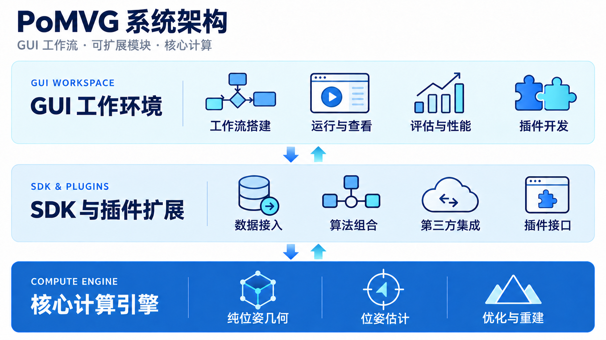
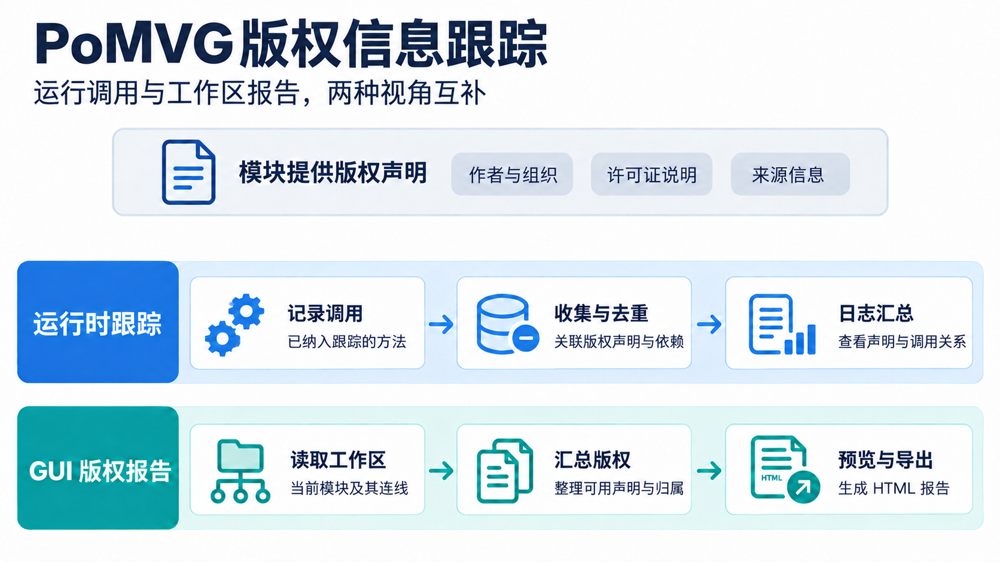

PoMVG 用户指南
===============

**GitHub 仓库**: https://github.com/pose-only-vision/PoSDK

PoMVG是一个面向 **空间视觉计算 (Spatial Visual Computing)** 的C++软件平台，可用于3D多视图几何处理，包括相机位姿估计、特征点云生成等。

PoMVG 提供 GUI 图形界面和 CLI 命令行两种使用方式。GUI 用于搭建工作流、运行算法、查看精度和性能报告，并在三维视图中比较结果；CLI 适合重复运行和批量处理。

**后续功能更新与用户文档以 GUI 版本为主。** v1.0.0 的说明保留为历史参考。

想先用起来？阅读 :doc:`快速开始 <installation/cli_gui_guide>`，
从 ETH3D 数据关联和运行开始，接着查看评估、性能、版权信息和三维结果，再按需要了解 Agent、IDE 和插件开发。

核心特性
--------

- **纯位姿几何理论**：基于纯位姿成像几何进行相机位姿估计与点云重建。在 GUI 中选择相应工作流、关联图像数据后即可运行。
- **模块化插件系统**：将数据读取、算法处理和结果输出组织成工作流节点，通过拖放、连线和修改配置组合功能；开发者还可以加入自己的插件。
- **性能分析工具**：在 **Profiler（性能）** 中查看已记录的模块耗时、CPU 和内存统计，并导出 CSV，定位运行较慢的步骤。
- **自动评估功能**：在 **Evaluator（评估）** 中查看旋转、平移等已记录的精度指标，比较均值、中位数和图表，并导出数据；精度评估需要相应参考数据。
- **版权跟踪**：自动收集算法及依赖库的版权声明，在节点的 **信息** 页查看，或通过 **导出 → 版权信息** 汇总成报告。
- **多语言日志**：提供中英文日志，方便在控制台查看运行进度和错误；界面语言可在 **偏好设置 → Language（语言）** 中切换。
- **平台集成与对比**：通过已安装的 OpenMVG、COLMAP、GLOMAP 等平台插件处理数据，结合评估指标和三维可视化比较结果。已有结果见 :doc:`评测结果 <benchmark_comparison/results>`。

GUI 中的基本使用顺序是：**打开工作流 → 关联数据 → 运行 → 查看精度与性能 → 检查三维结果 → 导出报告**。
Agent 可辅助解释和调整工作流，IDE 用于编写插件；不使用这两项功能，也能运行已有工作流。

系统架构
--------

PoMVG 以 GUI 工作流为使用入口，通过 SDK 组合算法模块，由核心计算引擎提供几何求解能力。运行结果返回 GUI，用于查看、评估和导出。

   GUI 组织工作流，SDK 连接可扩展模块，核心引擎完成计算。

主要包含以下组件：

- **GUI 工作环境**：搭建工作流、配置数据、运行算法，查看点云、精度和性能，并提供插件开发工具。
- **SDK 与插件扩展**：通过可组合的模块接入数据、算法与第三方平台；开发者可按需要扩展处理步骤。
- **核心计算引擎**：提供纯位姿几何、位姿估计、优化与重建能力。

保存的工作流也可由 CLI 执行，适合重复运行与批量处理。

版权跟踪与知识产权保护
------------------------

PoMVG 内置了 **版权自动跟踪功能**。

为什么需要版权跟踪？
~~~~~~~~~~~~~~~~~~~~

一次重建可能组合多个算法与第三方工具。保留各组件提供的作者、组织和许可证说明，有助于了解算法来源、核对依赖并归档结果。

PoMVG 的解决方案
~~~~~~~~~~~~~~~~

PoMVG 的版权跟踪提供以下功能：

- **声明收集**：记录模块提供的可用版权信息。
- **运行时跟踪**：关联已纳入跟踪的方法调用，并汇总版权声明。
- **归并展示**：按版权标识整理相关方法，减少重复信息。
- **GUI 查看与导出**：按当前工作区的模块、连线和可用声明生成报告。

   运行时跟踪反映已记录的调用；GUI 报告反映当前工作区的模块与连线。

工作原理
~~~~~~~~

如上图所示，版权跟踪的工作流程如下：

1. **模块提供声明**：记录作者、组织、许可证说明等可用信息。
2. **运行时关联**：跟踪已接入记录机制的方法调用，整理声明与依赖关系，输出到运行日志。
3. **工作区汇总**：GUI 根据画布中的模块、连线和可用版权元数据整理报告。
4. **查看与归档**：在节点的 **信息** 页查看声明，通过 **导出 → 版权信息** 预览报告并导出 HTML。

两种视角可配合核对；GUI 工作区报告不展开模块内部的运行调用。

详细使用方法请参考：:doc:`版权跟踪功能文档 <copyright_tracking>`

自动评估功能
------------

PoMVG 内置了 **评估工具**，提供精度统计、结果比较和数据分析功能。

为什么需要自动评估？
~~~~~~~~~~~~~~~~~~~~

在科研和应用开发过程中，通常需要：
- 对比不同算法在相同数据集上的性能
- 评估同一算法在不同参数配置下的表现
- 统计分析评估结果（均值、中位数、标准差等）
- 导出 CSV，便于后续比较

**问题**：手动收集数据并计算统计值工作量大。

PoMVG 的解决方案
~~~~~~~~~~~~~~~~

PoMVG 的精度评估系统提供以下功能：

- **自动收集**：自动收集算法的评估结果（旋转误差、平移误差、重投影误差等）
- **智能分类**：按评估类型、算法名称、指标名称自动分类管理
- **统计分析**：自动计算均值、中位数、最大/最小值、标准差等统计量
- **CSV导出**：支持多种格式的CSV数据导出，便于后续分析
- **多类型备注**：支持为每个评估结果添加多种类型的备注信息（如视图对标识等）

详细使用方法请参考：:doc:`评估系统文档 <advanced_development/evaluator_manager>`

平台集成与对比
--------------

PoMVG 支持与多个主流三维重建平台进行集成和对比测试，包括 OpenMVG、COLMAP、GLOMAP 等。

为什么需要平台对比？
~~~~~~~~~~~~~~~~~~~~

当前主流的三维重建平台各有特色：
- **OpenMVG**: 经典的开源多视图几何库，提供完整的SfM流程
- **COLMAP**: 业界领先的三维重建系统，支持SfM和稠密重建
- **GLOMAP**: 新一代全局优化平台，专注于大规模场景快速重建

**问题**：如何客观评估不同平台在相同数据集上的性能和精度？

PoMVG 的解决方案
~~~~~~~~~~~~~~~~

PoMVG 提供了统一的对比测试框架：

- **统一数据格式**：支持将不同平台的输出转换为统一的数据格式进行对比
- **自动化测试**：通过配置文件和脚本实现自动化的批量测试
- **多维度评估**：
  - **性能对比**：运行时间、内存消耗等性能指标
  - **精度对比**：全局位姿误差（旋转/平移）、相对位姿误差等精度指标
  - **统计分析**：均值、中位数、最大/最小值、标准差等统计量

如何使用对比功能
~~~~~~~~~~~~~~~~

1. **准备数据**：确保数据集包含真值（ground truth）信息
2. **配置测试**：在配置文件中指定要对比的平台和参数
3. **运行测试**：使用提供的脚本执行自动化测试
4. **查看结果**：系统自动生成对比报告和可视化图表

详细的对比测试结果和分析请参考：:doc:`评测结果 <benchmark_comparison/results>`

---

**下一步**：按 :doc:`快速开始 <installation/cli_gui_guide>` 跑通第一组数据；尚未安装时，先阅读 :doc:`安装说明 <installation/index>`。

